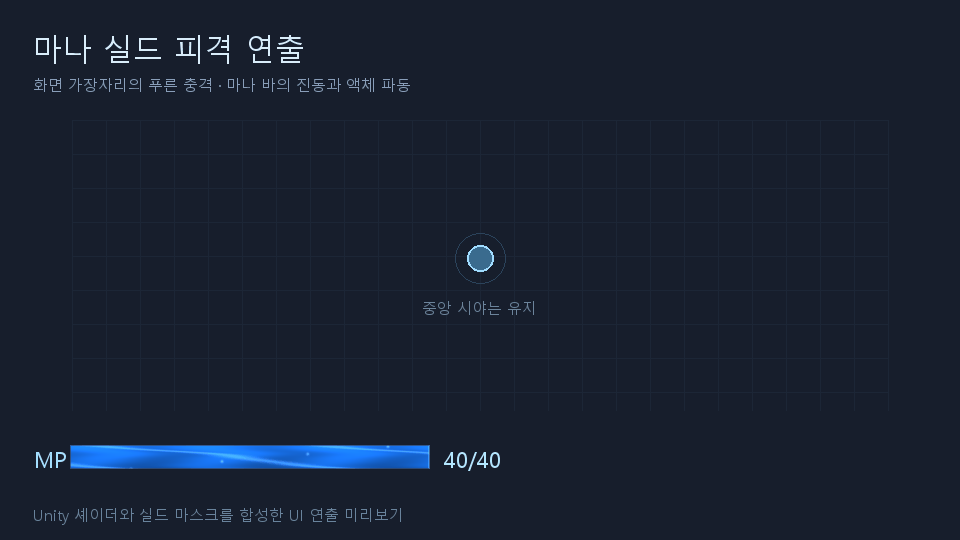

# 게임 시스템 구조

`GameManager`는 부분 클래스가 아닌 단일 MonoBehaviour이며, 씬 설정과 초기화·프레임 호출·종료 연결만 담당한다. 실제 게임 상태와 기능은 `Assets/Scripts/Systems`의 독립 C# 클래스가 소유한다. 별도 DI 프레임워크 없이 `ComposeServices`에서 생성자에 필요한 의존성을 전달한다.

## 기능별 책임

2026-10-26 추가: `CharacterArsenalSystem`은 타입별 두 보조 스킬의 유료 기본 시전 충전·자동 발동·수명·지속 영역·파편을 소유합니다. `CharacterCatalog`가 캐릭터당 3개 스킬과 영구 해금/강화 정의를 구성하고 레벨업은 해금된 스킬의 유효한 강화만 제공합니다. `EnemySpatialGrid`는 투사체·공전 충돌의 후보를 좁힙니다. `SpriteQuadBatch`는 각 드랍과 새 이펙트를 개별 데이터로 유지한 채 텍스처별 메시로 그립니다. 표시 개수 제한이나 드랍 수량 합산은 하지 않습니다. 자세한 구현 범위와 다음 플레이 리뷰 항목은 [속성 스킬](Elemental-skills.md)에 기록합니다.

`Player/Characters/CharacterCatalog`는 캐릭터 JSON과 공통/전용 성장 지도 카탈로그를 검증·구성합니다. `CharacterSession`은 선택/이번 런 캐릭터를 분리하고 `RunController.BeginRun`에서만 확정합니다. `ProgressionService`는 공통 행과 모든 전용 행의 스냅샷을 소유합니다. `GrowthGraphView`는 표시 카탈로그만 선택하므로 진행 중 전투 테이블을 교체하지 않습니다.

`Combat/CharacterMagicSystem`은 번개 연쇄·화염 부채꼴·화상 상태를 소유하며 피해/강화 조회는 좁은 콜백으로 주입받습니다. 발사체 관통·유도는 기존 `CombatSystem`에서 처리합니다. `SkillSystem`은 현재 캐릭터 강화 값을 집계하고, 새 게임의 기본 적중은 구 공용 발동 효과를 우회합니다. 구 테이블 직접 주입 테스트만 이전 효과 경로를 유지합니다. `LevelUpController`는 현재 캐릭터의 고유 강화만 선택지에 넣습니다. 이 전환 때문에 GameManager에 게임 로직을 추가하지 않습니다.

`LevelUpController`는 서로 다른 강화 종류를 최대 3개 고른 뒤, 카드마다 `UpgradeGradeRules`로 동·은·금 품질을 독립 추첨합니다. 같은 강화도 세 품질로 나올 수 있고, 테이블의 기존 `rarity`는 카드 품질을 결정하지 않습니다. 행운 0의 확률은 금 5%·은 35%·동 60%입니다. 행운 1당 금·은은 각각 0.2%p 늘고 동은 0.4%p 줄며, 동이 0%가 되는 행운 150에서 확률 변화를 멈춥니다. 품질별로 동 +1·은 +2·금 +3단계를 부여하고 남은 최대 단계까지만 적용합니다. 빙결의 냉기는 유효한 냉기 중첩 한도도 반영합니다. 추첨 시 확정한 실제 단계 증가량을 카드 설명과 선택 적용에서 함께 사용합니다. 레벨업 화면에는 이번 런의 행운과 세 품질 확률을 표시합니다.

공통 `luck` 성장은 단계당 금·은 확률 각각 +5%p, 동 확률 -10%p에 해당하는 행운 +25를 부여하며 최대 3단계입니다. 다른 영구 성장과 같은 저장·런 시작 스냅샷을 사용하고 구매는 다음 런부터 반영됩니다. 기본 행운에서 3단계를 모두 구매하면 금 20%·은 50%·동 30%입니다. 별도 Unity 프로젝트에서 네 캐릭터·행운 0/30/150의 실제 카드 72만 장을 추첨해 확률·중복 제외·등급별 효과·최대 단계 제한을 확인했습니다.

`Combat/FrostOrbitSystem`은 한 번 지불한 공전 마법의 수명·플레이어 추종·조각별 재타격 간격과 냉기 부여를 소유합니다. 회전 궤적을 작은 구간으로 나눠 빠른 공전/플레이어 이동 중에도 충돌을 판정합니다. `EnemySystem`은 냉기/빙결 타이머와 실제 감속·이동 정지를 처리하고, 재사용된 적의 애니메이터 속도/색상을 초기화합니다. 공전의 시각 풀과 실제 조각 수는 분리되어 연출 예산이 전투 피해를 바꾸지 않습니다. 시전은 공전 중에는 막고 마나 지불은 기존 `CombatSystem` 한 곳에서만 수행합니다.

스크립트는 다음 기능 폴더로 정리한다. GameManager만 `Assets/Scripts` 루트에 남기고, 관련 Unity 컴포넌트와 기존 헬퍼도 해당 기능에 함께 둔다. 클래스 이름·네임스페이스·스크립트 GUID는 이동으로 변경하지 않는다.

```text
Assets/Scripts/
├── GameManager.cs
└── Systems/
    ├── Core/          설정, 알림, 오브젝트 풀, 어셈블리 속성
    ├── Data/          테이블, 순수 규칙·데이터 모델, 런타임 엔티티
    ├── Assets/        에셋 로딩, 카탈로그, 스프라이트
    ├── Persistence/   저장, 저장소 인터페이스
    ├── Run/           런 타이머·결과 집계, 보스 도달
    ├── Stages/        스테이지 리소스 정의·선택·런 경계 적용
    ├── Combat/        몬스터, 공격, 스킬, 전투 수치·효과
    ├── Player/        플레이어 생성·이동·애니메이션·피격
    ├── World/         카메라, 필드 범위, 타일맵, 배치 미리보기
    ├── Pickups/       드롭·획득, 부유·상호작용 연출
    ├── Progression/   현재 런의 영구 성장 스냅샷
    ├── LevelUp/       경험치·선택 처리, 레벨업 카드 UI
    └── UI/
        ├── RunHudView.cs, DebugView.cs
        ├── Common/   공통 그리기·표시 모델
        ├── Growth/   성장 그래프 화면
        ├── Damage/   피해 숫자·크기 연출
        └── Results/  결과창·숫자 증가·보스 도달 화면
```

에디터 전용 도구는 기존 `Assets/Editor`, 회귀 테스트는 `Tests`에 유지한다.

| 영역 | 클래스 | 소유하는 상태와 역할 |
| --- | --- | --- |
| 데이터·저장·성장 | GameTables, SaveService, ProgressionService | 테이블 조회, 성장/목표 별도 인덱스와 표시 좌표, 영구 진행·저장 이관, 이번 런에 적용할 성장 스냅샷 |
| 런·마나·레벨업·보스 도달 | RunController, RunMana, LevelUpController, BossMilestone | 독립 보스 경과 시계·결과 집계·일시정지, MP 용량/소모/흡수, 경험치·선택 대기열, 보스 도달 상태 |
| 스테이지 | StageDefinition, StageSession | 두 스테이지의 룰타일·몬스터/보스 외형, 다음 런 선택, 현재 스테이지. 보스 전투/처치 해금은 미구현 |
| 월드·카메라 | PlayerWorld, GameplayCamera, WorldArtAssets | 플레이어 생성·이동, 추적·범위 제한, 기존 스프라이트·애니메이터 |
| 전투·플레이어 수치 | EnemySystem, CombatSystem, SkillSystem, CombatStats, PlayerStats, PlayerCombatSystem | 적 생성·사망, 투사체·치명타, 개별 발동 판정, 파생 공격 수치, 플레이어 영구 성장 수치, 피격 |
| 보상·연출 | PickupSystem, DamagePresentation, GameNotifications | 드롭·분수·획득, 피해 숫자, 알림 상태 |
| 화면 | GrowthGraphView, LevelUpView, RunHudView, RunResultView, BossArrivalView, DebugView, UiGraphics | 성장 그래프, 카드, HUD, 결과창, 보스 도달 화면, 디버그, 공통 그리기 |

기존 `GameObjectPool`, `ProjectDMAssetLoader`, `PrototypeSkillVisuals`는 Unity 컴포넌트로 유지하고 필요한 시스템에 주입한다. 효과 확률·구매 조건 등 순수 계산은 기존 `PrototypeRules`를 사용한다.

`EnemySystem`은 60초 간격의 중간보스도 소유한다. 같은 몬스터 프리팹/외형에 개체별 등급·크기/HP/보상 배율을 적용하고 사망 경로에서 보스 계열의 상자 1개 확정 드랍과 좁은 연출 콜백을 호출한다. `BossDeathRippleVisuals`는 월드 처치 지점의 배경 굴절만 담당하며 `PrototypeSkillVisuals`의 Tick/Clear 경로를 공유한다. 최종 보스 전투는 기존 도달 미리보기 상태다. 설정/검증은 `Docs/Art/Boss-death-ripple.md`를 참고한다.

`PlayerStats`는 `GameTables/ProgressionService`만 주입받아 이동속도·치명타 확률/피해량·무적 시간·끌어오기 범위·행운을 계산한다. 이동/전투/픽업 시스템에 같은 인스턴스를 주입하며, UI의 현재/다음 수치는 같은 계산식을 사용한다. 구매한 값은 `ResetSnapshot` 이후 다음 런에 적용된다. 별도 플레이어 체력과 체력 HUD는 없으며, `PlayerCombatSystem`은 접촉 피해만큼 `RunMana`를 소모하고 무적 시간을 적용한다. MP가 0이면 기존 런 종료 경로를 한 번 호출한다.

`PrototypeGrowthTable.goalLine`은 스테이지/보스 목표 경로이며 구매 가능한 성장 `rows/nodes`와 구분한다. `GameTables.graphLayoutNodes`는 중앙 12시 통로를 확보한 표시 좌표만 소유하고 구매 조건이나 저장 랭크를 바꾸지 않는다. `GrowthGraphView`는 두 종류를 하나의 카드 선택/툴팁/전체 보기로 표시하되 목표 칸을 클릭해도 구매·보스 처치를 기록하지 않는다. 스테이지 선택 UI는 별도로 `StageSession.Select`를 호출하며 실제 바닥/외형 교체는 다음 `BeginRun`의 리셋 경계에서 수행한다.

`StageDefinition`은 Resources의 두 에셋을 통해 바닥 룰타일/몬스터 5슬롯/보스 외형을 참조한다. 기존 Addressables 부트스트랩과 원본 씬/던전 아트는 유지한다. `StageArtPipeline`은 새 초원 아트와 보스 시트를 슬라이스하며 2스테이지 일반 몬스터는 원래 SpriteCatalog/추가 몬스터 시트를 연결한다. 일반 몬스터의 PPU는 기존과 같은 96이다. 슬롯별 Animator 참조가 있으면 해당 컨트롤러를 재생하고, 없으면 2프레임 수동 재생으로 하나의 렌더러에 한 애니메이션 소유자만 둔다. 풀링된 객체도 스폰 때 이 선택을 초기화한다. 실제 스테이지 1·2와 몬스터/재화 해금 단계 0~4는 독립이며 기존 5슬롯의 영구 처치/수치/드롭 규칙은 공유한다.

## 주입 원칙

`RunMana`는 최대/현재 MP·기본 공격 1회 비용·실제 누적 소모/흡수량을 소유한다. `CombatSystem`에 같은 인스턴스를 주입하여 유효 타깃이 있고 발사 간격을 통과한 한 묶음에 한 번만 비용을 지불한다. 다중 공격 추가탄·효과 피해·대기에는 별도 소모가 없다. `RunController.TickClock`은 마나를 건드리지 않고 보스 경과 시계만 진행한다. MP 고갈은 발사 직후 별도 종료 검사에서 처리하며 늦은 회복으로 부활하지 않는다. 적 사망 시 `PickupSystem`이 기존 독립 확률로 마나 방울을 드랍하고, 실제 획득 시 최대값까지 MP를 흡수한다. 실제 회복량 표시도 좁은 콜백으로 픽업 시스템에 주입한다. 저장의 `time/extension` 성장 ID는 유지한다. 과거 `health` 성장은 ID·구매 단계를 보존한 최대 마나 성장으로 전환하여, `time` 성장과 함께 런 시작 용량에 합산한다.

`UI/Mana`의 `ManaBarSettings`는 한글 설정/상태별 색상이고 `ManaBarRenderer`는 색상 전환·흐름 반응과 재사용하는 셰이더 렌더 타깃을 소유한다. GameManager는 Tick/Reset/Dispose와 공개 상태 전환 API만 연결하며 Hud는 텍스처를 그린다. 연출은 MP/전투 난수를 변경하지 않고 일시정지 중 멈춘다. 각성 게임 판정은 아직 없다.

- 시스템에 GameManager를 전달하지 않는다. 시스템이 GameManager를 검색하거나 `Update`를 자체 실행하지도 않는다.
- 실제 사용하는 시스템이나 좁은 콜백만 전달한다. 저장은 `IProgressStore`를 통해 접근하므로 테스트에서 PlayerPrefs 대신 메모리 저장소를 사용할 수 있다.
- 스킬의 치명타 판정·기본 피해 조회, 픽업의 경험치 전달 등 역방향 연결은 `Func`/`Action`으로 주입한다. 생성자 안에서 이 콜백을 실행하지 않으며 전체 구성 완료 후 호출한다.
- `GameSettings`는 설정값만 담는다. 적 목록·런 진행·구매 상태 등 전체 게임 상태를 모으는 컨텍스트가 아니다.

## 인스펙터·씬 호환

기존 GameManager의 직렬화 필드 이름·타입·기본값과 스크립트 GUID를 유지한다. 기존 씬 참조와 한글 커스텀 인스펙터는 그대로 사용할 수 있다. 실행 중 설정은 `GameSettings`에 동기화하므로 카메라 속도·피해 숫자·호버 연출 등을 계속 조절할 수 있다.

테이블 변경과 실험 모드 여부는 실행 시작 기준이며, 시작 시간과 영구 성장 효과는 다음 런의 초기화에서 적용한다. 실험 모드는 저장 서비스 생성 시 고정해 실행 중 인스펙터 변경으로 실제 저장이 켜지지 않도록 한다.

## 실행·초기화 순서

초기화는 테이블 검증 → 저장 로드/이관 → 시스템 주입 → 카메라 설정 → Addressables 로드 → 플레이어 생성 → 런 시작 순서다. 저장 형식 오류 시 기존 데이터를 덮어쓰지 않는다.

런 재시작 시 적·투사체·픽업을 풀로 반환하고 성장 스냅샷을 갱신한다. 임시 스킬·대기 운석·피해 숫자·플레이어 피격 무적·경험치·선택 대기열·보스 미리보기를 초기화한 뒤 타이머와 최초 적을 준비한다.

프레임 호출은 시간 → 플레이어/카메라 → 적 생성 → 발사 → 적 이동 → 투사체 적중 → 피해 숫자/스킬 효과 → 플레이어 접촉 피해 → 픽업 → 종료 판정 순서다. 일시정지 중에는 진행하지 않는다. 각 실제 적중은 별도 스킬 확률 판정이며, 효과 피해가 효과를 재발동하지 않는다.

## 검증

- `Tests/SystemCompositionRegression.ps1`: 독립 클래스·생성자 의존성·GameManager 역참조 금지·인스펙터 연결·저장 키·다음 런 스냅샷·적중별 판정 검사.
- `Tests/PrototypeProgressionRegression.ps1`, `Tests/CombatDamageScaleRegression.ps1`, `Tests/RunResultCountUpRegression.ps1`: 기존 규칙과 연출 계산 검증.
- 2026-10-26: 일회성 Unity 검증·임포트·초기 설치 스크립트와 폐기된 코인 임포터의 소스 검사를 삭제했다. 현재 에디터 메뉴와 남겨 둔 인스펙터는 [에디터 도구](Editor-tools.md)를 참고한다. 이 문서의 이전 제작 파이프라인 설명은 이력이며 현재 게임은 제작된 에셋과 32픽셀 카탈로그를 사용한다.

기존 테스트 전용 도우미 `RuntimeTestAccess`도 일회성 검증 스크립트와 함께 삭제했다.

성장 지도는 `Resources/ProjectDM/Data/GrowthTrees` 설정이 있으면 `GrowthTreeSettings`가 공통/캐릭터별 기본 그래프 위에 생성 노드와 연결을 적용한다. 성장 효과 ID와 구매 기록은 기존 테이블을 유지하고, 노드별 구매 구간은 동일 효과의 작성 순서로 계산한다. 작성 좌표는 추가 레이아웃 이동 없이 사용한다. 설정이 없으면 기존 기본 그래프를 사용한다. 편집·엑셀 양식은 [성장트리 에디터](Growth-tree-editor.md)를 참고한다.

피격 연출은 `PlayerCombatSystem`이 실제 잃은 MP를 좁은 콜백으로 `ManaBarRenderer.NotifyHit`에 알리는 구조다. `ManaHitFeedback`은 0.55초의 푸른 화면 가장자리, 감쇠하는 마나 바 위치 진동과 테두리 발광을 담당한다. 중앙 시야는 투명하며 캐시한 마스크 1장을 사용한다. `ManaLiquid.shader`의 별도 충격 시간·세기 값으로 내부 액체 충격파를 더하며 바의 잔량 경계는 움직이지 않는다. 일반 공격 소모/흡수나 무적 중 무시한 피격은 실드 충격을 발생시키지 않는다. `GameManager`가 독립 시간으로 충격을 진정시키므로 고갈로 런이 멈춰도 효과가 남지 않는다.

별도 Unity 프로젝트에서 마나 전투 24개 검사(접촉·무적·공격/흡수·고갈·재시작·이전 성장/소수 진행), 실드 충격 63개 검사(트리거 분리·정지 중 감쇠·중앙 투명·진동 범위·실제 GPU 물결)를 통과했다.



위 자료는 실제 셰이더 렌더·실드 마스크·진동 값을 합성한 UI 연출 미리보기다.

마나 바는 현재 MP 비율에 해당하는 가로 영역의 높이를 끝까지 채운다. 위쪽에 비어 있는 수면 영역이나 흔들리는 잔량 경계는 없으며, 내부 색 흐름·빛의 띠·기포만 움직인다. `ManaFlow.cginc`를 HUD와 성장 포션 셰이더가 공유해 같은 물 흐름을 사용한다. 기존 `waveSpeed/waveAmplitude/waveFrequency` 저장 필드는 흐름 속도·강조·빈도로 유지하며 Inspector 이름만 의미에 맞췄다. 별도 GPU 검사로 가득/절반/빈 MP 영역, 피격 시 고정 경계, 시간별 내부 흐름과 네 포션의 움직임을 확인했다.
