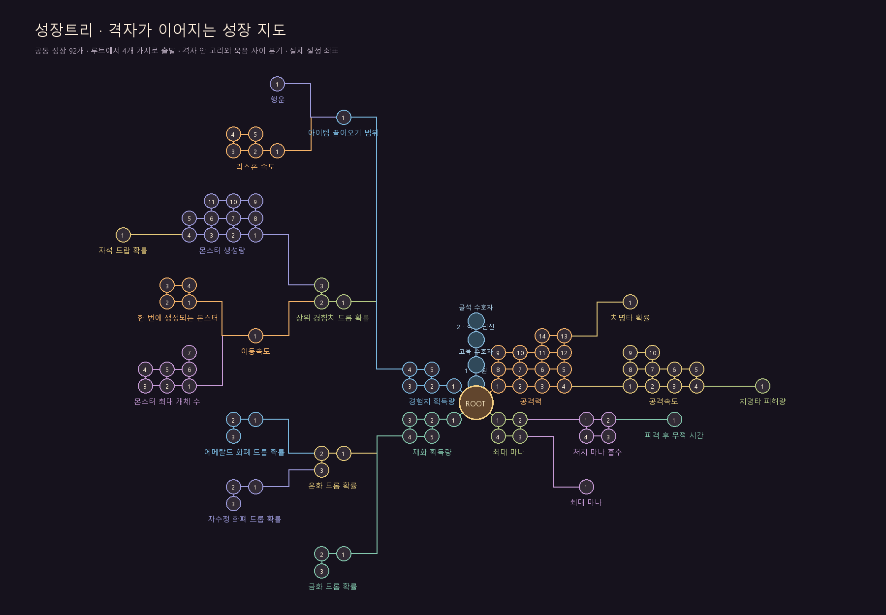
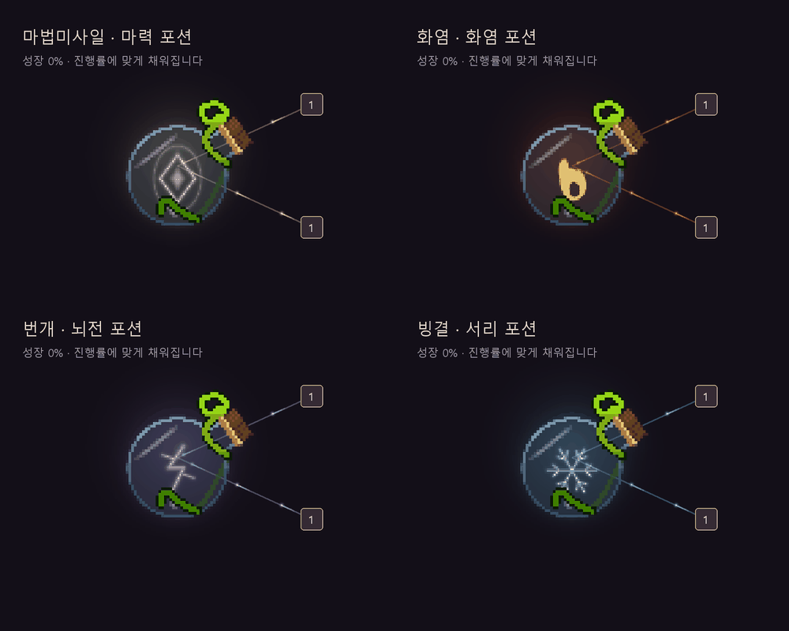

# 성장트리 에디터

Unity에서 **Project DM → 성장트리 편집기**를 엽니다. 공통 성장과 마법미사일·화염·번개·빙결 전용 트리를 각각 편집할 수 있습니다. 공통 92개 노드는 공격력·공격속도·마나·재화·행운·몬스터 밀도·자석 드랍 등 23가지 성장 종류별 영역에 모았습니다. 캐릭터 전용 지도는 스킬별 세 격자로 구성하며 전체 설정은 159개 노드·90개 효과입니다. 기존 성장 ID·저장 기록은 유지합니다. 새 구성과 다음 플레이 리뷰 범위는 [속성 스킬 문서](Elemental-skills.md)를 참고하세요.

성장마다 노드 수에 맞는 격자를 만들고, 격자 묶음들을 가지와 분기로 이어 성장 지도를 구성합니다. 공통 트리는 루트에서 공격·마나/생존·재화·경험치/필드의 네 갈래로 출발합니다. 캐릭터 전용 효과도 최대 네 갈래에서 시작합니다. 4개는 2×2, 9개는 3×3, 14개는 4×4 중 14칸을 사용하며 더 많은 노드도 격자가 커집니다. 격자 안의 가로·세로 이웃은 모두 연결해 네모 칸을 만들고, 다른 격자로 이어지는 선은 바깥 통로에서 직각으로 꺾습니다. 루트의 첫 연결은 대각선도 허용합니다. 큰 배경 박스와 묶음 제목은 게임·에디터에서 표시하지 않습니다. 위 배치도는 실제 설정 좌표와 연결을 그린 것으로 확인용 이름·번호·색상을 사용하며, 게임 화면 캡처는 아닙니다. 북쪽 중앙은 기존 스테이지·보스 목표 라인에 비워 둡니다. **전체 보기**로 전체 영역을 볼 수 있으며 공통과 각 캐릭터 전용 트리는 기존 탭/캐릭터 선택으로 분리합니다.

루트의 첫 노드는 X ±210 / Y ±160에 배치합니다. 첫 연결 길이는 이전의 약 ⅓이며, 각 가지를 함께 이동해 격자 간격과 연결은 유지합니다. 게임과 편집기는 처음 열 때 루트 주변을 확대해서 보여주며, **전체 보기**를 누르면 전체 지도에 맞춥니다. 일반적인 게임 화면의 초기 배율은 0.75이고, 작은 화면에서는 공간에 맞추되 노드 이름이 표시되는 0.4 이상을 사용합니다. 이미 가까이 보이는 작은 트리는 더 축소하지 않습니다.

게임 중앙의 ROOT는 구매용 사각 노드 대신 캐릭터 상징 UI로 표시합니다. 공통/전용 탭 모두 현재 선택한 캐릭터를 따릅니다. 중앙은 오른쪽 위 35도 방향으로 목이 기울어진 둥근 유리 포션입니다. 병의 외곽·반사·마개와 초록 줄기에 도트 질감을 섞습니다. 줄기는 병목을 감싼 뒤 끝이 둥글게 말리고, 다른 한 줄은 몸통 아래쪽을 감쌉니다. 줄기의 어두운 외곽과 연두색 하이라이트로 장식을 구분합니다. 액체는 낮고 느린 물결과 마나 바와 같은 내부 흐름을 사용합니다. `ManaFlow.cginc`의 공통 함수로 굽이치는 흐름과 가는 빛의 띠를 더해 병 안에서도 흐르는 물이 보이도록 합니다. 속성 심볼·기포·수면과는 분리해 적용합니다. 병 안에서 마법미사일은 빛나는 마력 문양과 궤적, 화염은 가운데가 비워진 불꽃 심볼, 번개는 가지가 갈라지는 뇌전 심볼과 방전, 빙결은 큰 눈꽃 심볼과 작은 결정이 움직입니다. 중앙 심볼은 액체 높이와 독립된 병 내부 장식으로 표시하며, 빈 병이나 내용물이 적은 상태에서도 같은 위치에 보입니다. 크기·선 두께·명암을 높이고 잔물결과 보조 효과는 차분하게 유지합니다. 액체 표면의 물결·기포와 유리 반사도 함께 표시합니다. 현재 탭의 전체 성장 노드에 대해 구매 단계/전체 단계를 합산해 액체 높이에 반영합니다. 숨겨진 노드와 예전 소수 진행도 포함하고 스테이지·보스 목표는 제외합니다. 모든 단계를 완료하면 병목을 포함한 내부 공간 전체를 액체로 채우고, 속성색의 넓은 후광과 유리 테두리 발광을 더합니다. 완료 직전의 액체 높이와 완료 여부는 분리되어 소수 진행이 100%로 반올림되어도 완성 효과가 먼저 나오지 않습니다. 전용 탭은 선택 캐릭터의 전용 성장 진행률을 사용합니다. 포션 아래 이름 텍스트는 표시하지 않습니다. 중앙 포션과 내부 심볼을 기존보다 1.5배 키우고, 전체 보기에서도 지나치게 작아지지 않도록 최소 표시 배율을 0.65로 제한합니다. 중앙에는 구매 단계·선택 테두리·클릭/호버 입력이 없습니다. 편집기의 ROOT는 연결 편집용 기준점으로 유지합니다.

구매한 노드의 연결에는 중앙을 향해 흐르는 빛을 표시합니다. 분할 노드를 일부만 구매했거나 예전 저장의 소수 진행이 있는 경우도 포함하며, 아직 구매하지 않은 미리보기와 목표 라인에는 흐름을 추가하지 않습니다. 직각 연결은 꺾인 경로를 따라 이동하고, 격자의 추가 연결도 ROOT에 가까운 방향으로 흐릅니다. 효과는 게임 일시정지와 독립된 시간으로 움직이며 전투 난수를 사용하지 않습니다.

기존 다음 단계 노출 판정은 유지합니다. 미노출 노드는 빈 칸·테두리·아이콘·텍스트를 모두 그리지 않으며, 일반/추가 연결선도 양쪽 노드가 모두 보일 때만 표시합니다. 숨겨진 노드는 클릭·호버·툴팁에서도 제외합니다.

위 효과 미리보기는 런타임의 GPU 포션 렌더와 시간별 그리기 명령을 합성한 자료입니다. 실제 화면의 노드 배치는 위 성장 지도 설정을 따릅니다.

## 엑셀에서 설정하기

`Design/GrowthTree.xlsx`에 현재 트리가 들어 있습니다.

1. **Nodes** 시트에서 생성할 노드를 정하고 아래 열을 편집합니다.
2. 에디터의 **엑셀/CSV 불러오기**로 파일을 엽니다. 불러온 값은 아직 편집 초안입니다.
3. 그래프와 오른쪽 설정을 확인한 뒤 **게임에 저장**을 누릅니다.
4. 다음 플레이 시작 시 설정이 적용됩니다. **엑셀 저장**으로 에디터에서 바꾼 내용도 다시 내보낼 수 있습니다.

| 열 | 의미 |
| --- | --- |
| treeId | `common`, `projectile`, `flame`, `lightning`, `frost` |
| enabled | `TRUE`/`FALSE` 또는 `1`/`0`. 생성할 노드만 켭니다. |
| id | 전체 트리에서 중복되지 않는 노드 ID |
| growthId | **Effects** 시트의 해당 트리에 구현된 성장 효과 ID |
| name | 게임에 표시할 노드 이름 |
| ranks | 이 노드에서 구매할 단계 수. 1~3입니다. |
| parent | 같은 트리의 해금 기준 부모 노드 ID. 시작점은 `ROOT`입니다. |
| parentRanks | 해금 부모의 필요 구매 단계. 0이면 추가 부모 구매 조건이 없고, 1 이상이면 실제 해금 조건이 됩니다. |
| x / y | 게임 성장 지도 좌표. 양의 Y는 아래 방향입니다. |
| displayParent | 화면에서 연결할 앞 노드 ID. 비우면 parent를 사용합니다. 예전 10열 양식도 읽을 수 있습니다. |
| displayOrthogonal | 선택 열. TRUE면 묶음 사이 통로에서 직각으로 꺾고 FALSE/빈칸이면 직선입니다. 루트의 첫 연결은 직선이며 대각선도 가능합니다. 수동 이동하면 직선으로 풀립니다. |
| displayLinks | 선택 열. 가로·세로 격자를 완성하는 추가 표시 연결입니다. 노드 ID를 `\|`로 구분합니다. 화면상의 고리는 허용하며 실제 구매 조건에는 영향을 주지 않습니다. 생략한 예전 양식은 추가 연결 없이 읽습니다. |

같은 `growthId`의 노드는 엑셀의 행/에디터 목록 순서대로 구매 구간을 나눕니다. 합계는 `Effects.maxRank` 이하여야 합니다. **Effects는 참고용**이며 효과 수치·가격·최대 단계는 기존 `PrototypeGrowth.json`과 `PrototypeCharacters.json`에서 관리합니다. **Guide**에는 양식 사용법이 들어 있습니다. 기존 전투에 없는 효과 ID는 새로 작성하는 것만으로 구현되지 않습니다.

UTF-8 CSV도 같은 헤더로 가져올 수 있습니다. 따옴표·쉼표·여러 줄 이름을 지원합니다. 파일에 생략한 트리는 현재 초안을 유지합니다. 트리 전체를 숨길 때는 행을 전부 지우기보다 해당 트리의 `enabled`를 모두 FALSE로 두세요. `.xls`는 `.xlsx`로 저장한 다음 가져옵니다.

## 에디터에서 연결·배치하기

- 노드를 선택하고 오른쪽에서 생성 여부·이름·성장 종류·구매 단계·해금 기준 부모·필요 구매 단계를 바꿉니다. **표시 연결**은 별도로 편집합니다.
- **표시 연결** 모드에서 앞 노드를 먼저 선택하고 다음 노드를 클릭합니다. 기본 표시 연결은 노드마다 하나이며 ROOT 연결도 가능합니다. 오른쪽 **추가 표시 연결**에는 노드 ID를 `|`로 구분하여 입력합니다. 추가 연결로 네모 고리나 여러 이웃 연결을 만들 수 있습니다.
- **격자 지도 정리**는 현재 트리의 활성 노드를 `growthId`별 격자로 모아, 루트의 네 가지에서 바깥으로 분기시킵니다. 격자 열 수는 노드 수의 제곱근을 올림하고 행 수는 필요한 만큼 사용합니다. 묶음 크기와 하위 가지 공간을 확보해 서로 겹치지 않게 합니다. 기본 표시 연결로 각 묶음의 노드를 잇고 추가 표시 연결로 가로·세로 이웃을 연결합니다. 위치와 표시 연결만 바꾸며 구매 조건은 유지합니다.
- 수동으로 드래그하거나 X/Y를 입력하면 그 노드에 연결된 직각 설정을 해제합니다. 대각선으로 자유롭게 연결할 수 있습니다. 오른쪽 **직각 연결**을 켜면 수동 연결도 꺾어서 표시할 수 있습니다.
- 노드를 드래그하여 위치를 바꾸고, 빈 공간/가운데 버튼 드래그로 화면을 이동합니다. 휠로 확대하고 **전체 보기**로 맞춥니다.
- **노드 추가**는 최대 단계에 여유가 있는 효과를 배치합니다. 이미 최대 단계가 모두 배치되어 있으면 기존 노드의 단계 수를 줄이거나 생성을 해제하여 여유를 만듭니다.
- 노드를 삭제하면 자식들은 삭제한 노드의 부모에 다시 연결되고, 그 노드를 참조하는 추가 표시 연결은 제거합니다. 오른쪽 **순서 위로/아래로**는 같은 효과의 구매 구간 순서에도 영향을 줍니다.
- Ctrl+Z/Ctrl+Y를 지원합니다. 편집 초안은 스크립트 재컴파일 중에도 유지됩니다.

없는 부모·생성 해제된 부모·중복 ID·기본 표시/해금 연결의 순환·서로를 기다리는 구매 조건·단계 초과는 저장하지 못하도록 오류를 표시합니다. 추가 표시 연결은 고리를 허용하지만 없는 노드·자기 자신·중복 ID는 오류입니다. 노드를 끈 뒤 표시 연결은 다시 지정하거나 격자 지도 정리로 재연결합니다. 실제 해금 부모를 끄면 해금 조건도 수정해야 합니다. 성장 종류 자체의 선행 효과(`Effects.requires`)도 유지합니다.

## 게임 적용과 저장 데이터

설정 에셋은 `Assets/Resources/ProjectDM/Data/GrowthTrees.asset`입니다. 런타임이 이 에셋을 읽어 실제 공통·캐릭터별 성장 그래프를 구성합니다. 설정 에셋이 없으면 기존 JSON/캐릭터 기본 그래프로 동작합니다. 스테이지·보스 목표 라인은 기존 설정을 유지합니다.

기존 구매 기록은 `growthId`별로 유지합니다. 노드 이름/ID/위치/분할을 바꾸면 기존 구매 단계가 새 구간에 표시됩니다. 노드를 끄거나 삭제해도 이미 구매한 능력치와 저장 기록은 지우지 않습니다. 게임 저장 데이터나 플레이 중인 런을 에디터가 직접 변경하지 않습니다. 창의 미저장 초안과 엑셀 파일도 자동으로 서로 덮어쓰지 않습니다.

검증은 별도 복사 프로젝트에서 수행했습니다. 기존 다섯 그래프의 구매 구간·연결·화면 위치 보존, XLSX 왕복 및 제공 양식 읽기, CSV 부분 가져오기, 생성 제외, 순환/선행 조건, 기존 구매 기록, 편집기 그리기·되돌리기·저장 실패 시 원본 유지까지 확인합니다. 기존 순수 성장 규칙 회귀 검사 16,505개도 통과했습니다. 일회성 검증 메뉴는 추가하지 않았습니다.

격자 지도 배치는 별도 Unity 프로젝트에서 컴파일 및 17,715개 검사를 통과했습니다. 5개 트리의 구매 데이터 보존, 네 갈래 출발, 격자의 가로·세로 이웃 연결, 노드 비겹침, 연결선의 다른 노드·목표 라인 통과 여부, 반복 배치의 동일 결과를 확인했습니다. 1×1부터 5×5까지의 격자와 빈 트리·비활성 노드, 잘못된 추가 연결도 포함합니다. 제공 엑셀의 95개 노드는 추가 연결까지 설정 에셋과 일치하고 Unity의 저장·불러오기 및 실제 게임 그래프 데이터로 이어지는지 확인했습니다. 루트의 첫 연결 거리, 1920×1080·1280×720·960×540에서 초기 확대와 전체 보기, 루트가 고정 패널에 가리지 않는지, 편집기의 초기 확대/전체 보기 분리도 확인했습니다. 기존 순수 성장 규칙 회귀 검사 16,505개도 통과했습니다.

미노출 렌더링은 새 저장·일부 구매·소수 진행·완료 저장을 5개 트리에 적용해 1,252개 검사를 통과했습니다. 숨김 노드 141개가 GUI 그리기 없이 반환하고 미구매 미리보기는 유지되는지 확인했습니다. 상징/흐름 효과는 743개 검사로 4종 포션, 두 탭의 캐릭터 전환, 중앙 선택 제외, 투자한 노드만 흐름 표시, 렌더 타깃 재사용, 꺾인 경로와 일시정지 중의 흐름을 확인했습니다. 포션 전용 50개 검사로 빈 병→중간→완료의 채움, 완료 시에만 강화되는 발광, 병목/몸통 상단을 포함한 모든 내부 픽셀의 채움과 심볼 밝기, 빈 병과 5% 진행 및 대체 렌더링의 심볼 노출, 같은 프레임의 진행률 변경 반영, 범위 제한, 대체 렌더링과 병 기울기도 확인했습니다. 미리보기는 실제 GPU 포션 렌더와 그리기 명령 64프레임을 합성해 시각 검토했습니다.

기존 최대 체력 성장은 최대 마나 성장(+20 MP/단계)으로 전환했습니다. 저장 호환을 위해 `health/health_1` ID와 기존 구매·소수 진행을 유지하며, `time` 성장과 함께 다음 런의 최대 마나에 합산합니다. JSON 기본 그래프·설정 에셋·엑셀의 이름과 설명도 같은 규칙입니다.

공통 행운 노드(`luck/luck_1`)는 경험치 성장 다음에 해금되며, 단계마다 금·은 확률 각각 +5%p, 동 확률 -10%p에 해당하는 행운 +25를 부여합니다. 최대 3단계 구매할 수 있습니다. 설명에 고정 확률 증가량을 표시하고 현재/다음 효과에 행운과 금·은·동 카드 확률을 함께 표시하며 다음 런에 반영합니다. 기본 행운에서 0/1/2/3단계의 금·은·동 확률은 각각 5%·35%·60%, 10%·40%·50%, 15%·45%·40%, 20%·50%·30%입니다. 같은 강화의 품질을 카드마다 독립 추첨하며 동·은·금은 각각 +1·+2·+3단계를 올립니다. 남은 최대 단계까지만 적용합니다.

행운 추가 후 설정 에셋과 제공 엑셀의 전체 96개 노드가 일치하는지 다시 확인했습니다. 갱신된 격자·엑셀 왕복 검사는 18,347개, 순수 성장 규칙 검사는 16,802개를 통과했습니다. 기존 노드의 구매 조건·가격·효과는 유지하고 행운의 새 행과 배치만 추가했습니다.
